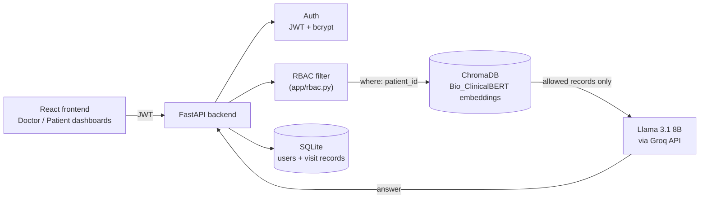

# MediCare AI

A role-aware AI assistant for Electronic Health Records (EHRs). Doctors and patients ask questions
in plain English and get answers grounded in medical records, while **role-based access control
(RBAC) decides which records can be retrieved before the AI ever sees them**.

Built by **D Maithreya** and **Aayush Sarraf**. We developed it together and pushed it as a
single commit at the end.

## Features

- **Retrieval-Augmented Generation (RAG):** records are embedded with
  [Bio_ClinicalBERT](https://huggingface.co/emilyalsentzer/Bio_ClinicalBERT), stored in ChromaDB,
  and the most relevant ones are passed to **Llama 3.1 8B** (via the Groq API) to write the answer.
- **Access control before retrieval:** a patient can only retrieve their own records; a doctor can
  search one patient or the whole clinic. The filter is applied inside the vector-database query,
  so unauthorized records are never returned to the model.
- **Doctor and patient dashboards** (React): chat over records and view visit history; doctors can
  also register other doctor accounts. The API additionally supports restricting a chat to chosen
  visit dates and adding new visits (`POST /ehr/add`).
- **JWT login** with bcrypt-hashed passwords.
- **Consistent deletes:** removing a patient clears them from SQLite, ChromaDB and the CSV source.

## Architecture



## How the access control works

`app/rbac.py` turns the logged-in user into a ChromaDB filter **before** any search runs:

| Role | Can retrieve | Filter applied |
|---|---|---|
| Patient | Only their own records | `{"patient_id": <their own id>}`, and a request for any other ID is refused |
| Doctor | One chosen patient, or all patients | `{"patient_id": <chosen id>}`, or no filter for clinic-wide search |
| Anything else | Nothing | Request refused |

Because the restriction is part of the database query rather than a check on the model's output,
the language model only ever receives records the user is allowed to see.

## Dataset

The ingestion scripts read **FHIR R4 patient bundles**: one JSON file per patient, as produced by
[Synthea](https://synthetichealth.github.io/synthea/), which generates **synthetic patients**.
No real patient data is used.

A tested source is the official Synthea sample:
[`synthea_sample_data_fhir_r4_sep2019.zip`](https://github.com/synthetichealth/synthea-sample-data/tree/main/downloads)
(1,180 patients). Unzip it so the `.json` files are inside a `datasetkaggle/` folder in the project root.

The dataset, the generated CSV and the databases are gitignored.

## Setup

**Requirements:** Python 3.10+, Node.js 20+, and a free [Groq API key](https://console.groq.com/keys).

```bash
git clone https://github.com/md25052007/MediCare-AI.git
cd MediCare-AI

# 1. Backend dependencies
python -m venv venv
source venv/bin/activate          # Windows: venv\Scripts\activate
pip install -r requirements.txt

# 2. Environment variables
cp .env.example .env              # Windows: copy .env.example .env
# then edit .env and set GROQ_API_KEY and SECRET_KEY

# 3. Build the databases from the dataset (datasetkaggle/ must exist)
python scripts/extract_csv.py     # FHIR bundles -> patient_structured_data.csv
python scripts/ingest_data.py     # embeddings -> ChromaDB (medical_db/)
python scripts/seed_users.py      # one patient login per patient
python sync_csv_to_sql.py         # visit records -> SQLite

# 4. Start the backend (API docs at http://127.0.0.1:8000/docs)
uvicorn app.main:app --reload

# 5. Start the frontend (in a second terminal)
cd frontend
npm install
npm run dev                       # opens on http://localhost:5173
```

**Logging in:** patients sign in with their patient ID and the `DEMO_PATIENT_PASSWORD` from `.env`.
Create a doctor account with `POST /register` (role `doctor`) from the API docs page.

## API

| Method | Endpoint | Purpose |
|---|---|---|
| POST | `/register`, `/login` | Create an account, get a JWT |
| POST | `/chat` | Ask a question about one patient or the whole clinic (RAG + LLM) |
| GET | `/search` | Semantic search over a patient's records |
| GET | `/patient/{id}/dates` | Visit dates available to the user |
| GET | `/ehr/{id}`, `/records/{id}` | Structured visit records |
| POST | `/ehr/add` | Add a visit (doctors only) |
| DELETE | `/patients/{id}` | Remove a patient from every store (doctors only) |

## Project Structure

```
app/
  main.py           FastAPI routes
  rbac.py           role-based access filter
  query_engine.py   retrieval + Groq LLM answer generation
  auth.py           JWT and password hashing
  config.py         settings, loaded from .env
  models.py, database.py, cleanup.py
scripts/
  extract_csv.py, ingest_data.py, seed_users.py, add_patients.py
  medical_encoder.py   Bio_ClinicalBERT embedding wrapper
frontend/
  src/components/   Login, DoctorDashboard, PatientDashboard, Header
```

## Security Notes

This is a demo project, so a few defaults are deliberately simple:

- Auto-created patient accounts share one demo password (`DEMO_PATIENT_PASSWORD`). A real
  deployment would issue individual credentials.
- CORS allows all origins to make local development easy; restrict it before deploying.
- `SECRET_KEY` must be set in `.env`; the app warns and uses an insecure development key if it is missing.

## License

MIT. See [LICENSE](LICENSE).
